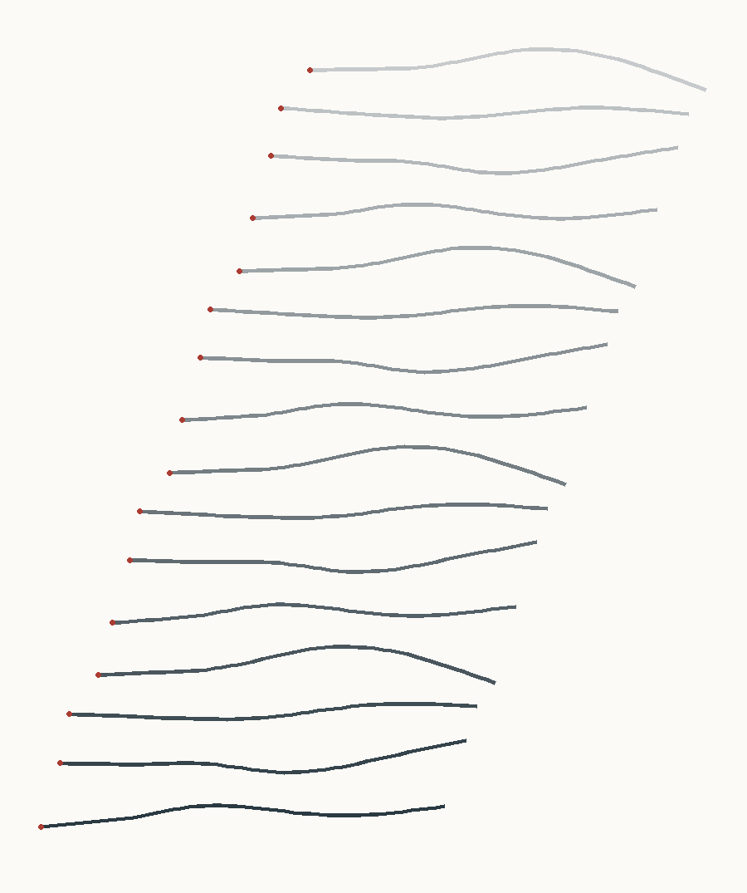

# Червь

Прогоны симулятора *C. elegans* `inbox/wormlisp/` (автор архива, Common Lisp, SBCL) на третьем уровне управления: сеть из 147 нейронов коннектома Cook et al. 2019.

## Как запустить

1. Скопировать `inbox/wormlisp` в `ext/wormlisp`, чтобы прогоны (`runs/`) не писали в inbox.
2. **Перевести переводы строк в LF.** Копия в inbox целиком в CRLF (855 файлов). На этом SBCL падает при сборке hunchentoot: перенос строки в форматной строке, `~` + `\r`, даёт «Unknown directive (character: Return)».
   `cd ext/wormlisp && grep -rlI $'\r' . | xargs sed -i 's/\r$//'`
3. `cd ext/wormlisp && sbcl --noinform --non-interactive --no-sysinit --no-userinit --load scripts/init.lisp --load ../../proekty/cherv/progon.lisp`
   Параметры идут в конце: `--end-toplevel-options <id> <набор> <секунды> <dt>`, например `moi-voda water-v1 6 5d-4`. По умолчанию `moi-1 agar-a-v1 12 1d-3`.
4. Картинка: `python3 proekty/cherv/hronofoto.py ext/wormlisp/runs/moi-1 proekty/cherv/moi-1-lesenka.svg 50 --lesenka` (рядом ляжет PNG; `50` — число колец)

## Прогоны

### moi-1: коннектом, агар, 12 с (2026-10-18)

Средняя линия тела каждые 0,5 с, с 4-й по 11,5-ю секунду. Каждый следующий момент нарисован ниже предыдущего, как на полосе Марея. Красная точка — голова, червь ползёт влево. Счёт занял 167 с стенных часов на 12 с модельного времени.

Метрики походки (с 4-й секунды). Модель считал `progon.lisp`, живого червя N2 тем же кодом — `zhivoj.lisp` (трек из `reference/schafer-n2-agar/`, Open Worm Movement Database, CC BY 4.0; у живого даны квартили):

| | модель | живой N2 | итог автора, этап 12 |
|---|---|---|---|
| скорость, мм/с | 0,085 | 0,074 / **0,092** / 0,122 | 0,078 |
| частота, Гц | 0,50 | 0,24 / **0,32** / 0,39 | 0,55 |
| длина волны, L | 0,93 | 0,54 / **0,62** / 0,72 | 0,92 |
| амплитуда кривизны, κL | 1,8 | 7,6 / **8,2** / 9,1 | 2,0 |
| проскальзывание | 0,18 | 0,49 / **0,64** / 0,74 | — |
| кривизна от головы к хвосту | 0,2 · 1,6 · 1,9 · 1,6 · 0,4 | 9,4 · 8,8 · 8,2 · 7,9 · … | — |

Что видно:
- **Прогон воспроизводит итог автора** (`docs/plan.md`, этап 12) с точностью около 10%. Расхождение, вероятно, от кода после этапа 12а; не проверял.
- **Скорость живая, а походка нет.** Модель ползёт с правильной скоростью, но совсем другим способом: изгибается в 4,5 раза мельче, длинной волной и почти без проскальзывания. Живой червь машет головой сильнее всего, и к хвосту изгиб плавно спадает. У модели передняя треть тела почти прямая (это видно и на картинке), а волна рождается в середине. Правильное итоговое число при неверном механизме.
- Автор знает причину: без источника ритма в голове волна по телу не идёт. Отсюда этап 12а, головной генератор (SMD, RMD). Он не завершён. Я нашёл то же самое глазами, с опозданием на два дня.
