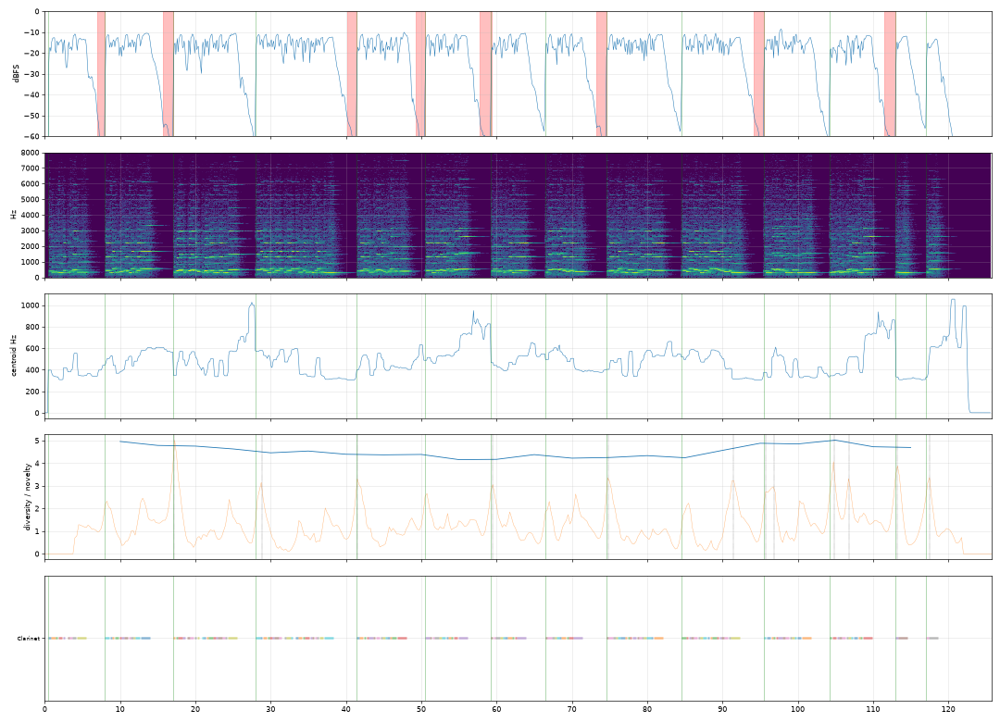

# Report: Devizy: de / qu

- length 125.8 s; level p10/p50/p90 -53.4/-17.1/-11.8 dBFS; peak -1.0 dBFS
- gaps ≥ 1 s below −50 dBFS: [(7.0, 8.0), (15.7, 17.1), (40.2, 41.4), (49.3, 50.5), (57.8, 59.3), (73.2, 74.6), (94.2, 95.5), (111.5, 113.0)]
- clipped samples: 0; isolated clicks at: none
- centroid median 483 Hz; share above 2 kHz median -25.1 dB
- flat stretches (diversity < 60 % of the median, 20 s windows): none
- strongest changes (novelty peaks), s: [17.2, 28.8, 41.5, 59.5, 74.8, 91.5, 95.8, 96.8, 104.8, 106.8, 113.2, 117.5]

## Score
- notes: 168, parts: 1, densest 10 s: 16 notes at 20–… s
- outside the real range of the instrument (matters for live players): none
- more than 5 semitones beyond the recorded range (resampled, may sound artificial): none

## Balance (each part alone, LUFS while it plays; the tune and the bass usually within ±3 dB)

| part | LUFS |
|---|---|
| Clarinet | -22.4 |

