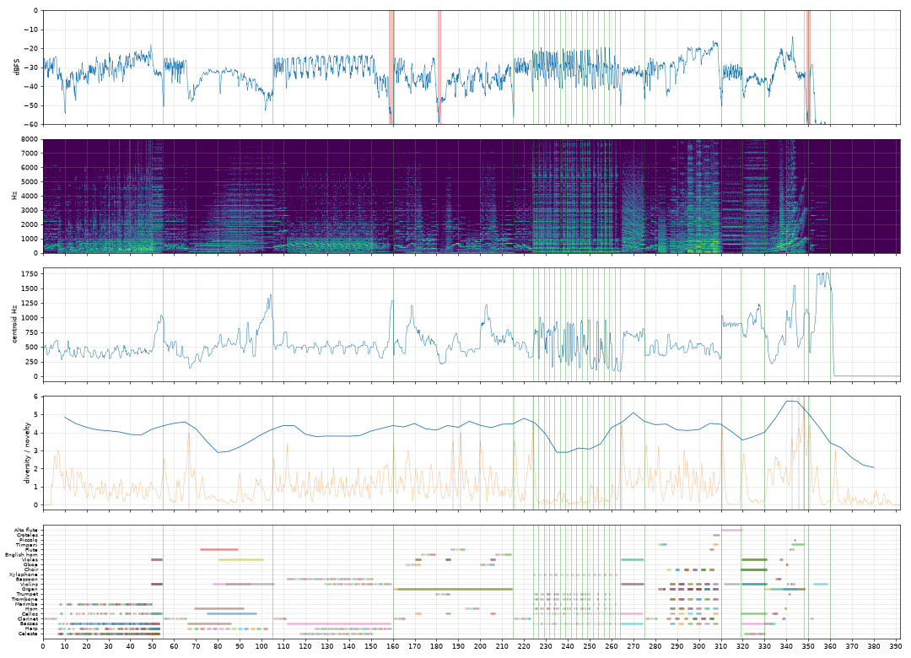

# Report: Tractatus: sieben Sätze

- length 392.0 s; level p10/p50/p90 -42.0/-32.3/-24.6 dBFS; peak -1.0 dBFS
- gaps ≥ 1 s below −50 dBFS: [(158.3, 160.4), (180.6, 181.7), (349.2, 350.7)]
- clipped samples: 0; isolated clicks at: none
- centroid median 504 Hz; share above 2 kHz median -23.8 dB
- flat stretches (diversity < 60 % of the median, 20 s windows): none
- strongest changes (novelty peaks), s: [66.8, 187.5, 191.0, 200.0, 215.5, 224.0, 264.8, 310.5, 342.5, 345.8, 348.0, 350.8]

## Score
- notes: 1417, parts: 22, densest 10 s: 190 notes at 40–… s
- outside the real range of the instrument (matters for live players): {'cb_pizz': 19, 'tbn_sus': 1}
- more than 5 semitones beyond the recorded range (resampled, may sound artificial): {'vln_harm': 10}

