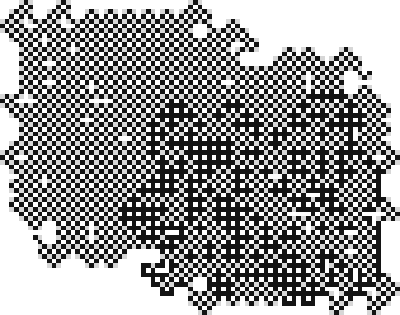

# Зоопарк турмитов 2×2

По одному представителю на тип. Номер — мой 16-битный код (см. NOTES.md), в скобках — нотация Пегга/Golly. Чёрное — клетки цвета 1, серое — где муравей побывал, белое — нетронутое поле.

## Муравей Лэнгтона — 99 (120080010010)

Одно состояние. ~10 000 шагов хаоса, потом шоссе периода 104.
Шагов: 12 000, размер 87×57.

## Двоичный счётчик — 3 (120010010010)

Одно состояние: на белом — покрасить и направо, на чёрном — стереть и прямо. Полоса шириной 2, каждая пара рядов — бит; каждое возвращение в начало = +1.
Шагов: 65 536, размер 2×28.

## Счётчик-крест — 14317 (141081180120)

Логарифмический рост в четыре стороны.
Шагов: 1 048 576, размер 31×31.

## Хаотический счётчик — 8827 (121180020020)

Шумное круглое пятно плотности ~0,52, но растёт как логарифм: +8–10 клеток за удвоение времени.
Шагов: 16 777 216, размер 128×124.

## Worm Trails — 11259 (121181121020)

Растёт 4 300 340 шагов, потом навсегда застывает в петле периода 28. Известное правило (Пегг 121181121020) — моя первая сверка.
Шагов: 5 000 000, размер 356×287.

## Застывшее пятно — 10135 (180111180020)

Петля периода 512 с шага 1 131 886. Его зеркало — 7147.
Шагов: 2 000 000, размер 259×260.

## Долгий хаос — 11087 (181040121020)

13 920 781 шаг хаоса, затем шоссе периода 152. Мой рекорд на 2^24 шагах (рекорды других людей — до 10^12).
Шагов: 14 101 389, размер 1810×2344.

## Шоссе с длинным периодом — 19349 (140111121040)

Период шоссе 53 076 шагов, смещение (38, 48) за период.
Шагов: 4 400 000, размер 1619×2056.

## Зигзаг — 12107 (121040181020)

Шоссе периода 41 407, смещение (25, 138): широкий извилистый ход.
Шагов: 1 200 000, размер 448×2067.

## Ромб — 16159 (181110181120)

Сплошной растущий ромб, размер ~ √t.
Шагов: 4 194 304, размер 2048×2048.

## Квадрат с диагоналями — 16921 (111110020040)

Растёт спирально, размер ~ √t.
Шагов: 4 194 304, размер 2322×2320.

## Линия — 54553 (111110140141)

Ходит взад-вперёд по линии и удлиняет её на клетку за проход: длина ~ √t.
Шагов: 4 194 304, размер 1×4095.

## Шумный квадрат — 3418 (021140141010)

Повёрнутый квадрат со случайной на вид начинкой, растёт ~ t^0.2.
Шагов: 16 777 216, размер 137×137.

## Решётчатое пятно — 10141 (141111180020)

Пятно с ажурной текстурой.
Шагов: 16 777 216, размер 85×67.

## Хаотическое пятно — 42350 (081080140021)

Типичный хаос: размер ~ t^0.37, единиц ~ t^0.75.
Шагов: 1 048 576, размер 108×113.

