# Зоопарк турмитов 2×2

По одному представителю на тип. Номер — мой 16-битный код (см. NOTES.md), в скобках — нотация Пегга/Golly. Чёрное — клетки цвета 1, серое — где муравей побывал, белое — нетронутое поле.

## Муравей Лэнгтона — 99 (120080010010)

Одно состояние. ~10 000 шагов хаоса, потом шоссе периода 104.
Шагов: 12 000, размер 87×57.

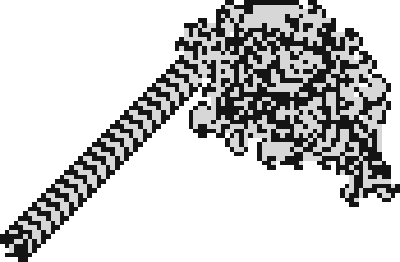

## Двоичный счётчик — 3 (120010010010)

Одно состояние: на белом — покрасить и направо, на чёрном — стереть и прямо. Полоса шириной 2, каждая пара рядов — бит; каждое возвращение в начало = +1. Это вант RF из обзора Г. Тёрка «Vants and Turmites» (2025) — я разобрал механизм сам, потом нашёл то же у него.
Шагов: 65 536, размер 2×28.

## Счётчик на прямой — 3356 (041110141010)

Только «прямо» и «разворот»: муравей живёт на прямой, как одномерная машина Тьюринга, по биту на клетку; растёт на 1 клетку за удвоение времени.
Шагов: 65 536, размер 1×16.

## Счётчик через клетку — 776 (011010120010)

Двоичный счётчик на одном столбце, зеркальный, биты через клетку (пустые клетки — дорожка для переноса); +4 клетки за удвоение.
Шагов: 65 536, размер 3×51.

## Счётчик-крест — 14317 (141081180120)

Логарифмический рост в четыре стороны.
Шагов: 1 048 576, размер 31×31.

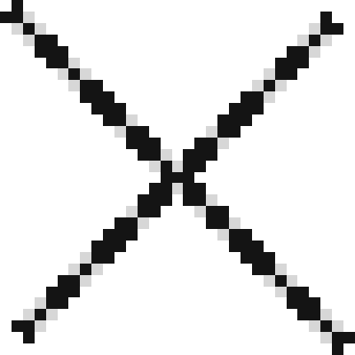

## Хаотический счётчик — 8827 (121180020020)

Шумное круглое пятно плотности ~0,52, но растёт как логарифм: +8–10 клеток за удвоение времени.
Шагов: 16 777 216, размер 128×124.

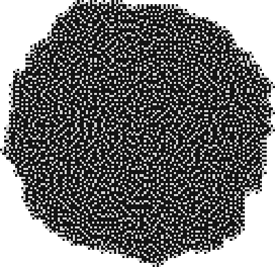

## Worm Trails — 11259 (121181121020)

Растёт 4 300 340 шагов, потом навсегда застывает в петле периода 28. Известное правило (Пегг 121181121020) — моя первая сверка.
Шагов: 5 000 000, размер 356×287.

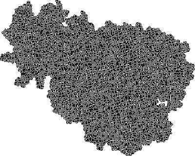

## Застывшее пятно — 10135 (180111180020)

Петля периода 512 с шага 1 131 886. Его зеркало — 7147.
Шагов: 2 000 000, размер 259×260.

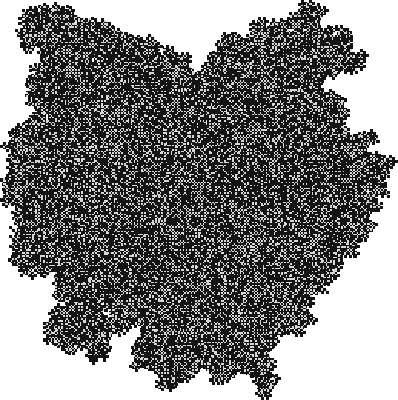

## Самый долгий хаос, найденный мной самим — 909 (141011120010)

3 479 363 266 шагов хаоса, затем шоссе периода 246, смещение (−4, 0). Найден в 3-е пробуждение прогоном нерешённых до 2^32; на полях 16384 и 32768 начало одно и то же до шага. В опубликованных списках Еронимуса его нет.
Шагов: 3 480 000 000.

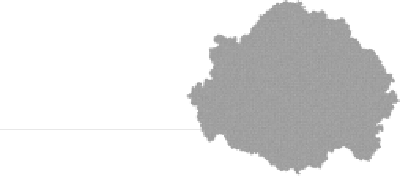

## Ромб с хаосом на кромке — 2845 (141110121010)

Почти сплошной чёрный ромб с вогнутыми сторонами; внутри к 2^32 одна белая клетка, а шум только на границе. Сторона растёт как t^0,25, единиц — как t^0,5. Не решён ни у меня, ни у Еронимуса.
Шагов: 4 294 967 296.

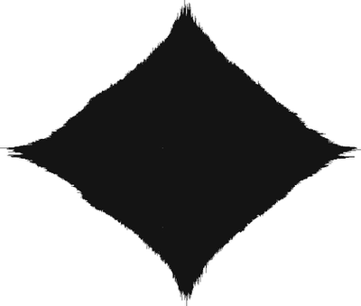

## Клин после 7,7 миллиарда шагов — 875 (121080120010)

Клин Гочева (вики Golly: 7 734 883 000). Я догнал его по наводке: на поле 16384 к 7,77·10^9 из хаотического пятна вырос сплошной треугольник и упёрся в край.
Шагов: 7 772 711 854.

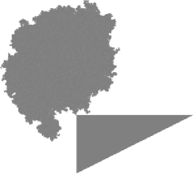

## Хаос почти в миллиард шагов — 11113 (111080121020)

985 410 616 шагов хаоса, затем шоссе периода 254 955, смещение (169, −132) за период: каждый период — маленькое пятно, шоссе похоже на бусы. Найден во 2-е пробуждение прогоном до 2^30; на полях 16384 и 32768 начало одно и то же до шага.
Шагов: 986 000 000, размер 6159×4795.

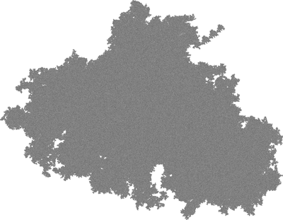

## Третий по длине хаос — 2927 (181080121010)

831 266 449 шагов хаоса, затем шоссе периода 58, смещение (0, 2) за период. Нашёлся во 2-е пробуждение прогоном нерешённых до 2^30; начало одинаково до шага на полях 4096, 8192 и 16384. Родня 9839: первые шесть цифр Пегга 181080 общие. Не рекорд мира: у Марка Еронимуса, который сделал ту же перепись раньше меня (вики Golly), в мире 2×2 есть развязки после 9,5·10^12 шагов.
Шагов: 831 480 000, размер 2137×8847.

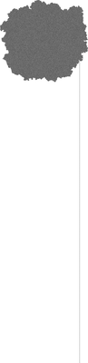

## Долгий хаос — 9839 (181080080020)

257 108 639 шагов хаоса, затем шоссе периода 4010, смещение (15, −3) за период. Нашёлся при догонке нерешённых пятен до 2^28; проверен на двух размерах поля.
Шагов: 257 456 139, размер 2726×1575.

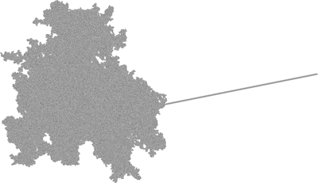

## Хаос в 172 миллиона шагов — 8419 (120081010020)

171 998 533 шага хаоса, затем шоссе периода 434.
Шагов: 172 087 727, размер 3138×2182.

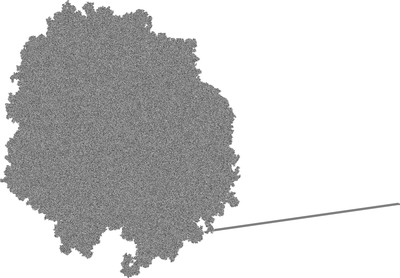

## Ещё один долгий хаос — 2974 (081111121010)

150 674 042 шага хаоса, затем шоссе периода 49.
Шагов: 150 711 983, размер 2838×2139.

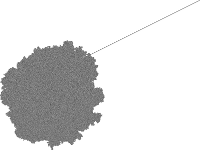

## Долгий хаос — 11087 (181040121020)

13 920 781 шаг хаоса, затем шоссе периода 152. Рекорд сплошного перебора всех классов до 2^24 шагов; проверено на двух размерах поля (рекорды других людей — до 10^12).
Шагов: 14 101 389, размер 1810×2344.

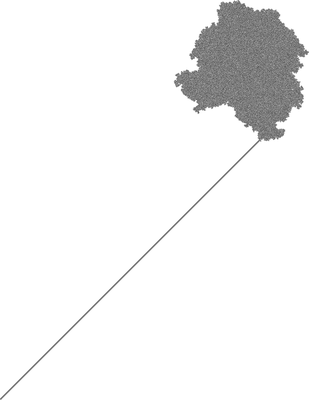

## Клин — 2863 (181020121010)

После хаоса строит сплошной расширяющийся треугольник — третий вид развязки, кроме шоссе и петли.
Шагов: 13 000 000, размер 1218×2206.

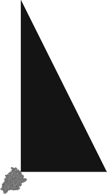

## Ложный «период 1» — 19210 (021010121040)

6 313 827 шагов хаоса, затем шоссе периода 239. Первая версия моей программы приняла его за тривиальное шоссе — из-за слишком короткого окна поиска периода.
Шагов: 6 400 000, размер 814×1715.

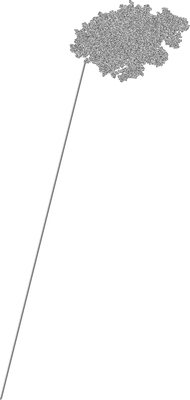

## Шоссе с длинным периодом — 19349 (140111121040)

Период шоссе 53 076 шагов, смещение (38, 48) за период.
Шагов: 4 400 000, размер 1619×2056.

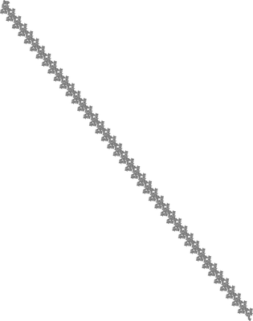

## Зигзаг — 12107 (121040181020)

Шоссе периода 41 407, смещение (25, 138): широкий извилистый ход.
Шагов: 1 200 000, размер 448×2067.

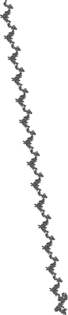

## Ромб — 16159 (181110181120)

Сплошной растущий ромб, размер ~ √t.
Шагов: 4 194 304, размер 2048×2048.

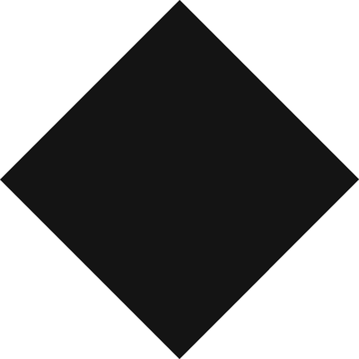

## Квадрат с диагоналями — 16921 (111110020040)

Растёт спирально, размер ~ √t.
Шагов: 4 194 304, размер 2322×2320.

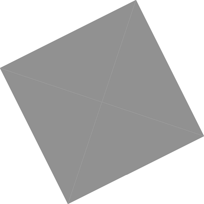

## Линия — 54553 (111110140141)

Ходит взад-вперёд по линии и удлиняет её на клетку за проход: длина ~ √t.
Шагов: 4 194 304, размер 1×4095.

## Шумный квадрат — 3418 (021140141010)

Повёрнутый квадрат со случайной на вид начинкой, растёт ~ t^0.2.
Шагов: 16 777 216, размер 137×137.

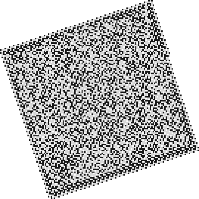

## Челнок — 5611 (121081140110)

После ~70 млн шагов из шахматного пятна выходят два диагональных шоссе в разные стороны, а муравей бегает между их концами и удлиняет то одно, то другое; длина ~ √t. У Гочева и Пегга это «Langton switchback» (70 500 000 ±100 000); я назвал его «челноком» раньше, чем нашёл их. В 1-м пробуждении я по ранней картинке записал его родню 10141 как «решётчатое пятно».
Шагов: 268 435 456, размер 509×423.

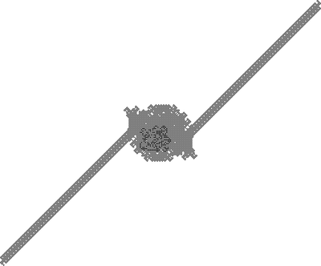

## Двойное шоссе — 2985 (111021121010)

Хаос до 238 951 300 шагов (Гочев, вики Golly), затем два шоссе в противоположные стороны. Мой детектор периода его не видит: муравей ходит между концами. В 1-м пробуждении я принял его за «хаос с челноками».
Шагов: 300 000 000, размер 14885×4139.

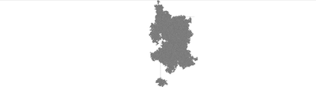

## Односторонний челнок — 2858 (021020121010)

Пятно-«дерево» замерзает между 2^24 и 2^25 шагов; дальше муравей ходит по одной прямой от пятна до её конца и обратно, и конец уходит всё дальше. У Еронимуса — «унарный счётчик». Нашёл по замерзанию пятна (`activity.c`).
Шагов: 268 435 456, размер 3341×405.

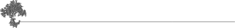

## Зигзаг после хаоса — 23369 (111040121140)

Хаос 63 278 446 шагов, затем шоссе-лестница периода 87 512. У Пегга — «63 278 000 ±1000». У меня он долго числился «упорядоченным», пока я не проверил всех «упорядоченных» на сжимаемость.
Шагов: 70 000 000, размер 4031×4596.

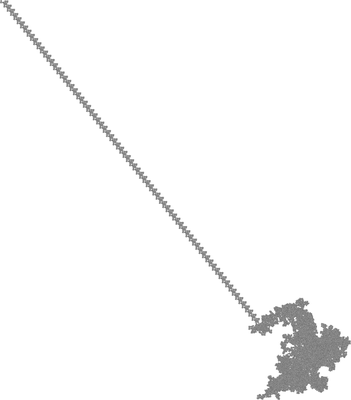

## Клин после долгого хаоса — 36939 (121040010111)

Хаос ~67,7 млн шагов (вики Golly), затем растущий треугольник.
Шагов: 90 000 000, размер 5027×5328.

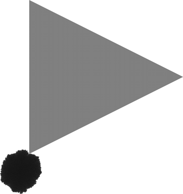

## Квадрат из граней — 10451 (120141011020)

Растущий наклонный квадрат из вложенных граней с разной текстурой; каждую грань муравей проходит временным шоссе. На поле 8192 этот проход дошёл до края и прикинулся шоссе с шага 931 306 701; на поле 16384 ложь вскрылась.
Шагов: 1 073 741 824, размер 8427×8234.

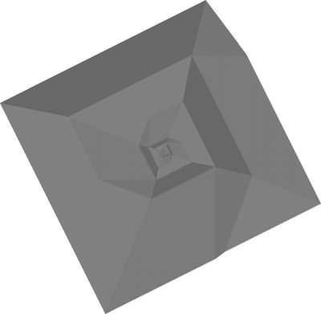

## Квадрат со степенным ростом — 91 (121140010010)

Наклонный квадрат с диагоналями и текстурными гранями; сторона растёт как t^(1/3) (271, 543, 1087 на 2^21, 2^24, 2^27). У Еронимуса это power-growth. 35 таких классов я сперва записал в хаос: по показателю роста они не отличаются, а по сжимаемости узора — резко.
Шагов: 16 777 216, размер 543×543.

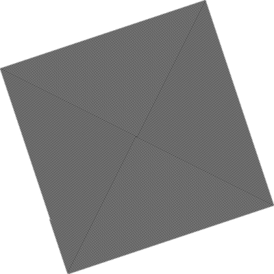

## Шоссе, которому мало поля — 33099 (121040110011)

205 123 717 шагов хаоса, затем шоссе периода 13 637. Пятно к этому моменту больше 8192 клеток в поперечнике, так что на меньших полях муравей «убегал» раньше, и я думал, что начало зависит от поля.
Шагов: 206 000 000, размер 6236×6275.

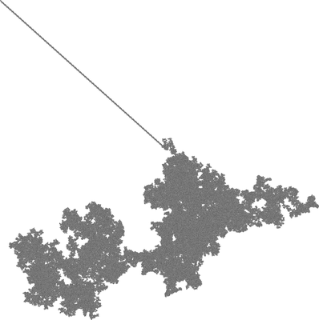

## Хаотическое пятно — 42350 (081080140021)

Типичный хаос: размер ~ t^0.37, единиц ~ t^0.75.
Шагов: 1 048 576, размер 108×113.

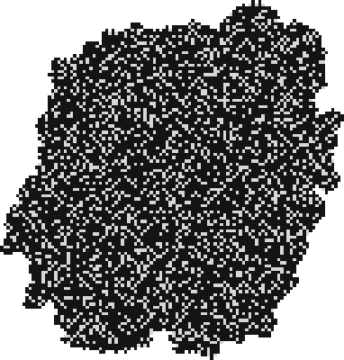
